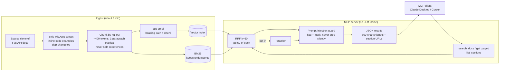

# Architecture and design trade-offs

An MCP server that lets Claude Desktop, Cursor or any MCP client search the FastAPI docs and cite the exact section. Hybrid retrieval reached 98% recall@5 and 0.86 MRR on 40 hand-written questions at 31 ms median, on a laptop CPU with no API keys.

**Why it exists.** Coding assistants answer from stale memory. Docs Brain gives the client's own model fresh, citable sections, and treats the docs as untrusted input.

## Architecture

Also exposed: a `docs://index` resource and an `explain_concept` prompt. Models and indexes load in a background thread so the MCP handshake answers immediately.

## Design trade-offs

| Decision | What I chose | What it costs |
|---|---|---|
| Where the LLM lives | None in the server; the client's model writes the answer | The server cannot check the answer it enables |
| Retrieval | Hybrid RRF, no score normalization | Two indexes; +5 ms over dense |
| Reranking | Off by default | Users who want it must opt in; on this set it lowered recall@1 and cost 55 to 350x the latency |
| Output size | 800-char snippets, `top_k` up to 10, pages capped at 20k chars | A long page can be truncated; saves the client's context window |
| Injection guard | Regex and decoding heuristics | Catches common attacks only; 0 false positives on 1,261 real chunks |
| Startup | Models and indexes load in a background thread | First query can wait; the MCP handshake answers immediately |

## What failed

- **Rerankers hurt.** `bge-reranker-base` and MiniLM both dropped recall@1 from 80% to 72%. `bge-reranker-base` pushed the correct CORS page from rank 1 out of the top 5 and took 10.9 s per query.
- **Each single retriever had blind spots.** Dense search missed "mount an existing Flask app"; BM25 missed "I don't want the client to wait for the email". Fusion fixed both.
- **The guard flagged an emoji.** The zero-width joiner inside the chef emoji in `async.md` tripped the zero-width rule; it is now allowed.
- **Four eval labels were wrong** and were corrected in an audit ([`eval/LABELS.md`](../eval/LABELS.md)).
- **Setup friction on Windows:** PyTorch paths exceed the 260-character limit in deep folders, and a running Claude Desktop can overwrite its own config; the installer script works around both.

## What I'd change

1. Grow the eval to 100+ questions with multi-page answers and graded relevance (nDCG); with 40 questions, one question is 2.5 points.
2. Add a small classifier (for example Prompt Guard) as a second guard layer, and scan at index time too.
3. Incremental indexing instead of a 3-minute full rebuild.
4. Make the library pluggable: today, swapping FastAPI for another library means editing paths and cleanup rules in `ingest.py`.
